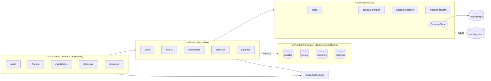
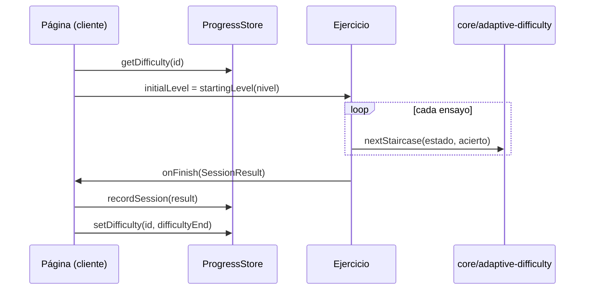

# Arquitectura de Gimnasio Mental

Documento vivo. Las decisiones de fondo están en [ADR-0001](adr/0001-arquitectura-base.md). Si se cambia algo de aquí que contradiga un ADR, hay que escribir un ADR nuevo.

## 1. Visión general

Es un monolito modular local-first sobre Next.js (App Router). Cada módulo del producto es una feature aislada. Todas comparten un núcleo de dominio puro (`src/core`) y una persistencia detrás de un puerto (`ProgressStore`).



Las dependencias van siempre hacia dentro: `app → features → core`. `core` no importa nada del proyecto salvo sus propios archivos.

## 2. Árbol de carpetas objetivo

```
src/
  app/                               # Rutas. Finas: componen features, sin lógica de dominio
    layout.tsx                       # Shell + navegación (lee MODULES)
    page.tsx                         # Inicio
    patio/
      page.tsx                       # Catálogo de juegos (lee el registro de la feature)
      [juego]/page.tsx               # Carga diferida del juego
    lectura/
      page.tsx
      [textoId]/page.tsx
    habilidades/
      page.tsx
      [ruta]/page.tsx
      [ruta]/[leccion]/page.tsx
    bienestar/
      page.tsx
      [practica]/page.tsx
    progreso/page.tsx                # Esqueleto
    recompensas/page.tsx             # Placeholder "próximamente"
    rankings/page.tsx                # Placeholder "próximamente"
  core/                              # Núcleo compartido: SOLO LECTURA para las features
    types.ts
    adaptive-difficulty.ts
    spaced-repetition.ts
    storage.ts
    modules-registry.ts
  components/
    ui/                              # Primitivas accesibles compartidas (botón, tarjeta, layout)
    exercise/contract.ts             # Contrato React de los ejercicios (ver 3.3)
    progress-store-provider.tsx      # Única instancia del ProgressStore en cliente
  features/
    patio/
      registry.ts                    # Lista de juegos: añadir juego = añadir entrada
      games/
        ajedrez/{domain/, AjedrezGame.tsx, index.ts}
        sudoku/{domain/, SudokuGame.tsx, index.ts}
        stroop/ go-no-go/ busqueda-visual/ n-back/ secuencias/ pares/ patrones/ deduccion/
      components/                    # UI propia del módulo
      index.ts                       # API pública del módulo
    lectura/{domain/, components/, index.ts}
    habilidades/{domain/, components/, index.ts}
    bienestar/{domain/, components/, index.ts}
    progreso/{domain/, components/, index.ts}
  content/
    patio/ajedrez/tacticas-basicas.json
    patio/sudoku/...
    lectura/textos-*.json
    habilidades/<ruta>/*.json
    bienestar/meditaciones-*.json
    index.ts por módulo               # Loaders tipados: () => import("./x.json")
```

Reglas de cada feature:

- `domain/` es TypeScript puro y testeable sin DOM. No importa React.
- Los componentes solo orquestan: llaman al dominio y a `ProgressStore`.
- `index.ts` es lo único que se puede importar desde `src/app`.

## 3. Contratos compartidos

La fuente de verdad es `src/core/types.ts`. Aquí se resumen sus piezas.

### 3.1 Núcleo (React-free)

| Tipo | Para qué sirve |
|---|---|
| `ModuleSlug`, `ModuleDefinition` | Identifican cada módulo con `slug`, `title`, `description`, `href` y `status: "activo" \| "proximamente"`. Con ellos se construye la navegación. |
| `DifficultyLevel` | Entero de 1 a 10. `DifficultyRange` limita el rango de cada ejercicio. |
| `ExerciseDefinition` | Metadatos de un ejercicio: `id`, `module`, `kind`, `skills` (los `CognitiveSkill` que trabaja), `difficulty`, `estimatedMinutes`, `adaptive`. |
| `SessionResult` | Evento inmutable de fin de sesión: `id` (UUID), `schemaVersion`, `exerciseId`, `contentId?`, `startedAt`/`endedAt` en ISO UTC, `outcome`, `difficultyStart`/`difficultyEnd`, `trials`, `correct`, `meanReactionMs?`, `score`. |
| `ReviewCard` | Estado Leitner de un ítem: `id = deckId:itemId`, `box`, `dueAt`, `reviews`, `lapses`, `updatedAt`. |
| `ProgressSnapshot` | Estado local completo (sesiones, dificultad por ejercicio, tarjetas). |
| `ProgressStore` | Puerto asíncrono de persistencia (ver 3.2). |
| `ContentPack<T>`, `ContentLoader<T>` | Paquete de contenido versionado (`id`, `version`, `module`, `locale`, `items`) y su cargador diferido. |

### 3.2 `ProgressStore` (puerto de persistencia)

```ts
interface ProgressStore {
  getSnapshot(): Promise<ProgressSnapshot>;
  recordSession(result: SessionResult): Promise<void>;          // idempotente por result.id
  listSessions(filter?: { module?: ModuleSlug; exerciseId?: string }): Promise<SessionResult[]>;
  getDifficulty(exerciseId: string): Promise<DifficultyLevel | undefined>;
  setDifficulty(exerciseId: string, level: DifficultyLevel): Promise<void>;
  listReviewCards(deckId: string): Promise<ReviewCard[]>;
  upsertReviewCards(cards: readonly ReviewCard[]): Promise<void>;
  reset(): Promise<void>;
}
```

Adaptador actual: `createLocalProgressStore()` en `src/core/storage.ts`.

- **Clave y formato.** Guarda en la clave `gm:progress` con el sobre `{ v: PROGRESS_SCHEMA_VERSION, data }`.
- **Al leer:**
  - si la versión es antigua, aplica `migrations[n]` paso a paso de n a n+1 y reescribe;
  - si los datos son inválidos, los respalda en `gm:progress:respaldo` y empieza vacío;
  - si la versión es futura, trabaja en memoria en solo lectura y no sobrescribe.
- **En servidor o sin almacenamiento** trabaja solo en memoria.
- **Límite:** guarda como máximo 1000 sesiones (FIFO).

**Cómo cambiar el esquema:**

1. Subir `PROGRESS_SCHEMA_VERSION`.
2. Añadir `migrations[versionAnterior]`.
3. Ajustar `isProgressSnapshot`.
4. Escribir una prueba con datos de la versión anterior.

**Cómo usarlo:** los consumidores reciben el store desde `progress-store-provider.tsx`. Nunca llaman a `localStorage` directamente. Las preferencias de UI propias de un módulo usan `readVersioned`/`writeVersioned` con una clave con prefijo del módulo (`gm:<modulo>:...`).

### 3.3 Contrato de ejercicio en React (`src/components/exercise/contract.ts`)

Vive fuera de `core` porque depende de React. Lo crea `frontend-specialist`.

```ts
interface ExerciseProps {
  definition: ExerciseDefinition;
  initialLevel: DifficultyLevel;            // startingLevel(await store.getDifficulty(id))
  onFinish(result: SessionResult): void;    // el contenedor persiste: recordSession + setDifficulty
  onExit(): void;
}

interface ExerciseEntry {
  definition: ExerciseDefinition;
  load: () => Promise<{ default: ComponentType<ExerciseProps> }>;   // code splitting por juego
}
```

`features/patio/registry.ts` exporta `readonly ExerciseEntry[]`, y las demás features hacen lo mismo con lo suyo. Añadir un juego son cuatro pasos:

1. Crear la carpeta en `games/`.
2. Añadir su contenido en `content/patio/`.
3. Añadir una entrada en el registro.
4. Ya está: la ruta dinámica `[juego]` lo resuelve por `definition.id`.

### 3.4 Flujo de una sesión



Los ids se generan con `crypto.randomUUID()` en el cliente. Las fechas se generan con `new Date().toISOString()`.

## 4. Algoritmos

### 4.1 Dificultad adaptativa: escalera 2-arriba/1-abajo

Es `src/core/adaptive-difficulty.ts`.

- **Regla:** dos aciertos seguidos suben un nivel; un fallo baja uno. Siempre dentro del `DifficultyRange` del ejercicio.
- **Por qué:** converge hacia un 70,7 % de aciertos (Levitt, 1971). Es una zona exigente pero alcanzable, coherente con la práctica deliberada y la zona de desarrollo próximo. Una dificultad que se queda fija produce aburrimiento si es baja y abandono si es alta.
- **Inicio de sesión:** `startingLevel(ultimo) = ultimo - 1`, un escalón de calentamiento.
- **Inversiones:** se cuentan en `reversals`. Al final de la sesión, el nivel estable se puede estimar con la media de las últimas inversiones, si un ejercicio lo necesita.
- **Qué significa el nivel:** cada juego define qué cambia con él. Por ejemplo:
  - n-back: el valor de n y la velocidad;
  - Stroop: la proporción de ensayos incongruentes y el tiempo límite;
  - go/no-go: la proporción de no-go y el ISI;
  - búsqueda visual: el número de distractores;
  - sudoku y ajedrez: el nivel elige el banco de contenido.
- **Granularidad:**
  - en juegos de ensayo rápido (Stroop, n-back) se aplica por ensayo o por bloque;
  - en sudoku y ajedrez se aplica por puzzle.

### 4.2 Repetición espaciada: Leitner de 5 cajas

Es `src/core/spaced-repetition.ts`.

- **Intervalos:** 1, 3, 7, 14 y 30 días, para las cajas 1 a 5.
- **Acierto:** la tarjeta sube a la caja siguiente.
- **Fallo:** vuelve a la caja 1 y suma un `lapse`. La UI debe volver a preguntar los fallos dentro de la misma sesión.
- **Repaso:** `selectDueCards(cards, now, 20)` limita cada repaso a 20 tarjetas. Así se controla la carga cognitiva y la sesión no se convierte en un feed infinito.
- **Por qué Leitner y no SM-2:** se entiende sin explicaciones ("caja 3 de 5"), usa una sola calificación binaria (más fácil de responder con honestidad que una escala de 0 a 5) y aprovecha las dos cosas que tienen más evidencia: el efecto de espaciado (Cepeda et al., 2006) y la práctica de recuperación (Roediger y Karpicke, 2006). Si hiciera falta afinar más, se puede pasar a SM-2 con una migración del esquema. `box` se convertiría en `interval` y se añadiría `ease`.
- **Dónde se usa:**
  - en Habilidades, en las preguntas de recuperación de cada lección;
  - en Lectura, en las ideas clave de los textos ya leídos.

## 5. Contenido como datos

- Cada paquete es un `ContentPack<T>` en JSON o TS dentro de `src/content/<modulo>/`. El tipo `T` lo define la feature en su `domain/`; por ejemplo, `ChessPuzzle { id, fen, solution: string[] (UCI), alternatives?: string[][], theme, rating }`.
- **Cargadores.** Cada módulo exporta un `Record<string, ContentLoader<T>>` con `() => import("./pack.json")`. Cada paquete sale como un chunk aparte y se carga solo al entrar en su ruta.
- **Estabilidad de ids.** Los `id` de ítems y paquetes no cambian una vez publicados, porque las tarjetas y las sesiones los referencian. Si un ítem cambia de forma significativa, se le da un id nuevo.
- **Validación.** Mientras el contenido sea interno basta el tipado y una prueba que valide los paquetes. Cuando venga de una API se validará al cargar, con un type guard en la feature.
- **Textos de Lectura.** Deben ser de dominio público o con licencia compatible. Hay que registrar la fuente y la licencia en el paquete.

## 6. Rutas y code splitting

| Ruta | Render | Carga diferida |
|---|---|---|
| `/` y páginas índice de módulo | Server Component estático | — |
| `/patio/[juego]` | Shell estática + hoja cliente | El componente del juego (`entry.load()`) y su paquete de contenido |
| `/lectura/[textoId]` | Shell estática + lector cliente | El texto y sus preguntas |
| `/habilidades/[ruta]/[leccion]` | Igual | La lección y las tarjetas del mazo |
| `/bienestar/[practica]` | Igual | El guion de la práctica |
| `/progreso` | Hoja cliente (lee el store) | — |
| `/recompensas`, `/rankings` | Placeholder estático | — |

- **Rutas dinámicas.** Usan `generateStaticParams` a partir de los registros, para que todo se pueda prerenderizar.
- **Acceso al almacenamiento.** Lo que lee `ProgressStore` va siempre en un Client Component hoja, nunca en un layout. Con `cacheComponents` activado, la shell queda estática y la parte local se hidrata después.
- **Rendimiento.** Ningún juego se importa de forma estática en índices ni en layouts.

## 7. Límites entre módulos (trabajo en paralelo)

| Ruta | Propietario | Los demás pueden |
|---|---|---|
| `src/core/**` | Arquitecto | Solo importar. Los cambios se hacen por PR revisado y deben ser aditivos; un cambio incompatible exige ADR y migración. |
| `src/core/modules-registry.ts` | Arquitecto | Solo añadir entradas (append-only) o cambiar el `status` de su propio módulo. |
| `src/components/ui/**`, `src/components/exercise/**`, `progress-store-provider.tsx` | frontend-specialist | Solo importar. Si falta una primitiva, se pide. |
| `src/app/layout.tsx`, `src/app/page.tsx`, `globals.css` | frontend-specialist | Solo lectura. |
| `src/features/<m>/**`, `src/content/<m>/**`, `src/app/<m>/**` | Desarrollador del módulo `<m>` | No se tocan las de otro módulo. |
| `docs/adr/**`, `docs/ARQUITECTURA.md` | Arquitecto | Proponer cambios por PR. |

Reglas de importación:

1. `src/core` no importa nada fuera de `src/core`, y tampoco `react`, `next` ni APIs del DOM. La única excepción es `storage.ts`, que accede a `window.localStorage` con guarda.
2. Una feature no importa de otra. Si dos features necesitan lo mismo:
   - si es dominio, se propone llevarlo a `core`;
   - si es UI, a `components/ui`.
3. `src/app/<m>` solo importa de `@/features/<m>` (su `index.ts`), de `@/components` y de `@/core`.
4. `progreso` lee los datos de los demás módulos solo a través de `ProgressStore` (`SessionResult.module`), nunca importando sus features.
5. Las claves de almacenamiento llevan prefijo: `gm:progress` es del núcleo y `gm:<modulo>:*` es de cada módulo.

Se puede imponer con ESLint sin dependencias nuevas. Ejemplo mínimo para añadir a `eslint.config.mjs`:

```js
{
  files: ["src/core/**"],
  rules: { "no-restricted-imports": ["error", { patterns: ["react", "react-*", "next", "next/*", "@/features/*", "@/components/*", "@/app/*"] }] },
},
{
  files: ["src/features/patio/**"],
  rules: { "no-restricted-imports": ["error", { patterns: ["@/features/*", "!@/features/patio", "!@/features/patio/**"] }] },
},
// repetir por feature
```

## 8. Criterios de diseño cognitivo (vinculantes para todos los módulos)

1. **Honestidad.** El texto de la app no promete "subir el IQ", prevenir la demencia ni curar nada. La evidencia muestra mejoras en la tarea entrenada y transferencia lejana limitada (Melby-Lervåg y Hulme, 2013; Simons et al., 2016). Se habla de "practicar" y "entrenar la atención en esta tarea". El progreso se mide y se muestra por tarea.
2. **Sesiones con final.** Cada ejercicio tiene una duración o un número de ensayos acotado (5 a 15 minutos) y una pantalla de fin explícita. No hay autoplay, ni feeds infinitos, ni notificaciones push.
3. **Variedad.** Como la transferencia es estrecha, la app recomienda alternar dominios (atención, memoria, lectura, habilidades reales) en vez de repetir un solo juego.
4. **Sin patrones oscuros.** No se castigan las rachas rotas, no hay urgencia artificial y el futuro sistema de recompensas premia la constancia, no el tiempo en pantalla.
5. **Bienestar.**
   - No sustituye a la terapia. En las pantallas de manejo emocional habrá un enlace visible a recursos de ayuda profesional y de crisis (en España, el 024).
   - La respiración se puede detener en cualquier momento y no propone hiperventilación sostenida.
   - Lo que se escribe en el registro emocional nunca sale del dispositivo sin un consentimiento explícito y separado.
6. **Accesibilidad.** Los ejercicios con tiempo límite tienen un modo sin límite o ampliado (WCAG 2.2.1). Se respeta `prefers-reduced-motion`. El Stroop tiene una variante que no depende solo del color.

## 9. Camino de evolución

| Fase | Qué cambia | Qué no cambia |
|---|---|---|
| **0. Local-first (actual)** | `createLocalProgressStore`; exportar e importar JSON desde Progreso | — |
| **0.5. IndexedDB** (si el estado pasa de unos 2 MB) | Nuevo adaptador `ProgressStore` sobre IndexedDB nativo; migración única desde localStorage | Contratos, features, UI |
| **1. Backend y cuentas opcionales** | API REST `/v1`; adaptador `SyncedProgressStore` que escribe en local y envía los eventos pendientes; vinculación de los datos locales a la cuenta con consentimiento | Features, contratos de dominio |
| **2. Rankings y recompensas** | Se calculan en el servidor a partir de los eventos `SessionResult`; los módulos `recompensas` y `rankings` pasan a `activo` | El resto de módulos |

Notas para la fase 1. El borrador del contrato, que se detallará en OpenAPI 3.1 cuando llegue el momento, es este:

- `PUT /v1/me/sessions/{id}`: idempotente, porque el `id` lo genera el cliente. Responde 201 o 200.
- `POST /v1/me/sessions:batch`: hasta 100 eventos.
- `GET /v1/me/progress?since=<ISO>`.
- `PUT /v1/me/review-cards/{id}`: resuelve conflictos con `updatedAt` (gana el último).
- `PUT /v1/me/difficulty/{exerciseId}`.
- Los errores siguen RFC 9457 (`application/problem+json`).
- Autenticación con sesión en cookie `HttpOnly; Secure; SameSite=Lax`.
- Hay que hacer una auditoría de seguridad (`security-audit`, `api-security`) y un análisis de RGPD antes de lanzar.

Notas para la fase 2:

- Nunca se confía en el `score` que envía el cliente. El servidor recalcula o comprueba la plausibilidad (duración frente a número de ensayos, tiempos de reacción por debajo de 150 ms).
- Los rankings son opt-in. Se recomiendan ligas por mejora personal frente a la propia línea base, mejor que una tabla global, por coherencia con el propósito anti-doomscrolling.

## 10. Riesgos

| Riesgo | Mitigación |
|---|---|
| Pérdida de datos al borrar el navegador | Aviso en Progreso, exportar/importar JSON, `navigator.storage.persist()` cuando se implemente IndexedDB |
| Dos pestañas escriben a la vez (gana la última) | Aceptado en fase 0; el evento `storage` permite refrescar la caché si molesta |
| Cuota de localStorage | Límite de 1000 sesiones; paso a IndexedDB según el umbral de la fase 0.5 |
| El validador propio de ajedrez falla en casos especiales (enroque, captura al paso, promoción) | Pruebas unitarias con FEN de cada caso; criterio documentado para adoptar `chess.js` |
| Desarrolladores que se pisan | Tabla de propiedad, reglas de ESLint, núcleo de solo lectura |
| Promesas clínicas exageradas en el texto | Criterio 8.1 revisado en la revisión de UX |
| Contenido con derechos de autor | Licencia y fuente obligatorias en cada `ContentPack` de lectura |

## 11. Siguientes pasos

1. **frontend-specialist:**
   - crear `components/ui`, `components/exercise/contract.ts` y `progress-store-provider.tsx`;
   - poner la shell y la navegación desde `MODULES` y cambiar `lang="es"` en el layout;
   - crear los placeholders de `recompensas` y `rankings`.
2. **Responsables de los módulos:**
   - crear `features/<m>/registry.ts` e `index.ts`, y un primer ejercicio por módulo con su paquete de contenido;
   - en Patio, empezar por Stroop, n-back y puzzles de ajedrez.
3. **Arquitecto o devops:**
   - añadir las reglas `no-restricted-imports` al config de ESLint;
   - proponer un ADR-0002 sobre el runner de pruebas (necesita autorización para instalarlo).
4. **qa-specialist:** pruebas unitarias del núcleo: escalera, Leitner y las ramas de `readVersioned` (vacío, ok, migrado, inválido, versión futura, no disponible).
